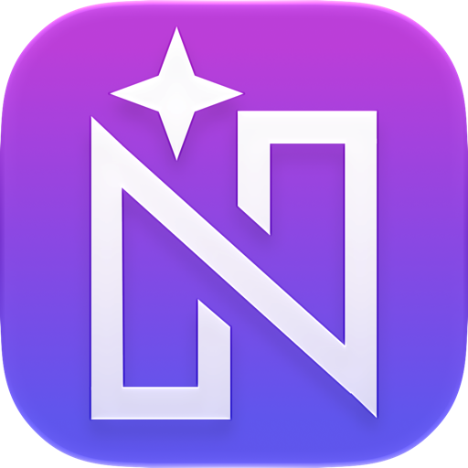
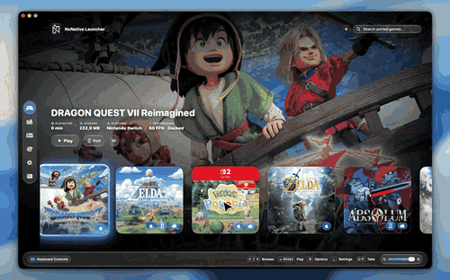

<div align="center">
  <a href="README.md"><b>Overview &amp; Guide</b></a> &nbsp;&nbsp;|&nbsp;&nbsp;
  <a href="SUPPORTED_GAMES.md"><b>Supported Games (155+)</b></a> &nbsp;&nbsp;|&nbsp;&nbsp;
  <a href="CONTRIBUTING.md"><b>Contributing</b></a> &nbsp;&nbsp;|&nbsp;&nbsp;
  <a href="https://gitlab.com/rennan-group2/nxnative_Launcher/-/releases/permalink/latest"><b>Latest Release (.dmg)</b></a> &nbsp;&nbsp;|&nbsp;&nbsp;
  <a href="https://github.com/seedds/nxnative"><b>Upstream Engine (seedds/nxnative)</b></a>
</div>

<br>

<div align="center">
  <p align="center">
    
  </p>
  <h1 align="center">NxNative Launcher</h1>
  <p align="center">
    <strong>AOT binary translation &amp; runtime for ARM64</strong><br>
    Apple Liquid Glass macOS, iOS/iPadOS &amp; Android Launcher for <code>nxnative</code> &amp; <code>nx2android</code><br>
    Native ARM64 NS 1 &amp; 2 recompiled software on <strong>Apple Silicon (<code>macOS 26.6+ Tahoe</code> &amp; <code>iOS 26.0+ / iPadOS 26.0+</code>)</strong> powered by <strong>Apple Metal 4</strong>, plus native <strong>Android APK</strong> runtime powered by <strong>Vulkan</strong>
  </p>
</div>

> [!IMPORTANT]
> **Disclaimer**: NxNative Launcher is an **anti-piracy** research and software preservation project. It does **not** distribute, host, or link to any proprietary game software, firmware, or system keys (`keys`), and it never will. It only works with software and keys that you legally dumped yourself from your own hardware. Piracy is not supported. This project is independent and is not affiliated with or endorsed by console manufacturers.

---

## Table of Contents

- [Overview](#overview)
- [iOS and iPadOS Companion App](#ios-and-ipados-companion-app)
- [Android Porting Support (`nx2android`)](#android-porting-support-nx2android)
- [What's New in v2.3.0](#whats-new-in-v230)
- [Supported Games & Hardware Tiers](#supported-games-and-hardware-tiers)
- [Quick Start & Upgrade Guide](#quick-start-and-upgrade-guide)
- [Action-Adventure Profile (0400486024DEC000) Optimizations](#action-adventure-profile-0400486024dec000-optimizations)
- [Zero-Hang Launcher Architecture](#zero-hang-launcher-architecture)
- [Project Structure](#project-structure)
- [Acknowledgements & Legal Notice](#acknowledgements-and-legal-notice)

---

## Overview

**NxNative Launcher** wraps [`seedds/nxnative`](https://github.com/seedds/nxnative) and [`shirai91/nx2android`](https://github.com/shirai91/nx2android) in a controller-friendly macOS experience built with **SwiftUI + Apple Liquid Glass**. Instead of traditional JIT emulation, games are ahead-of-time recompiled into native ARM64 binaries — Mach-O with SPIR-V shaders translated to **Apple Metal 4** for macOS and iOS/iPadOS, or native **Android APKs & Data Packs** with NVN graphics replayed on **Vulkan** for compatible Android devices.

<p align="center">
  
</p>

---

## iOS and iPadOS Companion App

Alongside macOS, **NxNative includes a native companion app (`frontend-ios` / `DmShell`) for iPhone and iPad (`iOS 26.0+ / iPadOS 26.0+` with Metal 4)** — built with the same controller-ready **Apple Liquid Glass Console Hub** aesthetic (`NXIosConsoleLibraryView`).

<p align="center">
  
</p>

### How the iOS & iPadOS App Works

1. **Standalone Game IPA or Multi-Game Console Hub (`DmShell`)**:
   - Port titles from the macOS Launcher in either mode: build a self-contained **standalone per-game `.ipa`** or deploy the unified **Console Hub (`DmShell`)**, where ported NS titles appear as embedded frameworks in a single console-style library complete with promotional artwork, game states, and Quick Play.
2. **High-Speed USB AFC RomFS Transfer & Identity Verification**:
   - To avoid slow multi-gigabyte `.ipa` installations, large game **RomFS data is streamed directly over USB via Apple File Conduit (`afcclient` / `libimobiledevice`)** into the app's `Documents` sandbox, guarded by cryptographic identity verification (`RomfsIdentityVerifier`) and on-device caching so verified data is never re-copied needlessly.
3. **Automated IPA Health Check & Deployment (`devicectl` / AltServer)**:
   - Prior to deploying via Apple `devicectl` or generating packages for sideloading (AltServer / SideStore), the macOS Launcher runs **IPA Health Diagnostics & Auto-Repair**, validating the executable binary, `Info.plist`, and split `.metallib` shader libraries.
4. **Adaptive Touch Controls, Layout Editor & Gamepad Support**:
   - Features dedicated **2D**, **3D**, and **Tap** on-screen touch layouts (including swipe-to-look 3D right-stick camera control), a built-in interactive **Touch Layout Editor** (`TouchLayoutEditorView`) for resizing and repositioning every button, plus full **Bluetooth / USB Controller support** (auto-hiding touch overlays when a physical controller connects, with per-game button remapping).
5. **Liquid Glass Themes, Per-Game Settings & iCloud Cross-Save**:
   - Customize highlight themes and language inside the Personalization drawer (`PersonalizationSheetView`), adjust per-game frame rate, render scale, docked/handheld mode, and rumble toggles (`ShellSettingsView`), and share saves (`save/`) across Mac, iPhone, and iPad with automatic backup exclusion for heavy game data.

---

## Android Porting Support (`nx2android`)

NxNative Launcher integrates [`shirai91/nx2android`](https://github.com/shirai91/nx2android) directly into the **Port** modal and **Compatibility** browser, allowing you to compile native Android `.apk` packages and game data packs alongside macOS and iOS/iPadOS ports:

1. **Optional Android Toolchain Setup**:
   - Android porting tools (**Android NDK** and **ADB**) are **optional** and never forced on startup — install or remove them anytime from **System → Tools** or directly inside the Port modal when selecting **Android**.
2. **Unified Port Modal & ADB Deployment**:
   - Select **macOS**, **iOS/iPadOS**, or **Android** directly in the Port modal (`scripts/port_android.py` bridges `nx2android` progress events seamlessly into the launcher build pipeline).
3. **Live `nx2android` Compatibility Sync**:
   - The **Compatibility** tab fetches live updates from both [`seedds/nxnative`](https://github.com/seedds/nxnative) (macOS / iOS / iPadOS) and [`shirai91/nx2android`](https://github.com/shirai91/nx2android) (Android), and lets you filter games across **macOS**, **iOS**, **iPadOS**, and **Android**.
4. **Supported Android Hardware**:
   - Requires a Snapdragon (**Adreno** 6xx/7xx/830, with Turnip Vulkan driver support where noted) or Exynos (**Xclipse** RDNA) GPU capable of BC-compressed textures. **Mali** and **PowerVR** GPUs are unsupported. NS 2 (`0400...` / NUP) packages are currently macOS-only for Android.

---

## What's New in v2.3.0

- **Controller X/Y/A/B Mapping Fix & `DM_INPUT_MAPPING` Host Support**: Enforces unique 1-to-1 `SwitchButton` bindings in the remapping overlay (`ControllerMappingCalloutOverlay`) to eliminate duplicate command triggers, and restores per-player `DM_INPUT_MAPPING` (`input_mapping.json`) remapping + analog deadzone support in the macOS host (`dm/host/front_mac.m`).
- **Full Gamepad Navigation Across Modals**: Makes all toggles, sliders, segmented pickers, presets, controller profile slots, iCloud Cross-Save switches, and iOS device/team/storage options across Game Settings and Port Modals individually focusable and controllable via D-Pad, Left/Right, and A/B.
- **Title Profile (`0400486024DEC000`) Motion Blur Hotpatch Fix**: Adds ARM64 instruction-cache invalidation (`sys_icache_invalidate`) to `oot_motion_blur_hotpatch` in `dm/host/loader.c` and updates the bundled profile engine binary (`dmhost`).
- **`nx2android` Auto-Updater & Toolchain Sync**: Automatically updates the `nx2android` backend when Android NDK/ADB prerequisites are installed and refreshes compatibility matrices immediately after toolchain provisioning.

## What's New in v2.2.9

- **Live `nx2android` Compatibility Sync & Platform Filter**: Synchronizes Android compatibility directly with [`shirai91/nx2android`](https://github.com/shirai91/nx2android) alongside `seedds/nxnative`, adds a **macOS / iOS / iPadOS / Android** platform filter on the Compatibility screen, and cleans up compatibility badges without emojis.
- **Automatic Missing Cover Art Discovery**: Automatically searches and caches missing covers for newly added compatibility titles using public title database metadata search, `docs/images/covers`, and Steam store library fallback.
- **Optional Android APK Porting (`nx2android`)**: Adds optional Android NDK/ADB provisioning in System Settings and unified macOS / iOS/iPadOS / Android platform selection in the Port modal (`scripts/port_android.py`).
- **Upstream Engine & Profile Updates**: Includes `seedds/nxnative` MSL 3.2 barrier and texture alias fixes, Universal Shader Chain Compatibility v2, NS 2 Native Mouse mode, and per-game Camera Motion Blur toggle for Title `0400486024DEC000`.
- **Guided Onboarding Wizard & Direct DMG Auto-Updater**: Checks prerequisites on first launch and installs GitLab `.dmg` updates automatically with animated Liquid Glass progress and relaunch.

---

## Supported Games and Hardware Tiers

NxNative currently tracks **155 tested game profiles** (`149 NVN`, `3 OpenGL`, `4 Vulkan`) across NS 1 and NS 2.

| Memory Tier | Mac Hardware | iPhone / iPad Hardware | Playable Catalog |
| :--- | :--- | :--- | :--- |
| **4 GB Tier** | Any Apple Silicon (M1+) | iPhone 15 Pro+ / iPad M1+ (8 GB) | 37 titles |
| **8 GB Tier** | M1 / M2 / M3 / M4 (8–16 GB) | A17 Pro+ / M2+ (8 GB) | 114 titles |
| **16 GB+ Tier** | 16 GB+ Unified Memory | Mac only for NS 2 (`NVN2`) | All 155 titles |

### Verified NS 2 Titles (`0400...`)

| Title ID | Type & Architecture | Profile |
| :--- | :--- | :--- |
| `040074A01BF12000` | 3D Platformer (`sead / agl / gsys`) · NVN2 | [Notes](dm/games/040074A01BF12000/README.md) |
| `04007EF01F8AE000` | Strategy RPG (Intelligent Systems) · NVN2 | [Notes](dm/games/04007EF01F8AE000/README.md) |
| `04003F40232DE000` | Action / Musou (KTGL) · NVN2 | [Notes](dm/games/04003F40232DE000/README.md) |
| `040077201BE50000` | Racing / Action (`phx / Aurora`) · NVN2 | [Notes](dm/games/040077201BE50000/README.md) |
| `0400C3F00006E000` | Kart Racing (`sead / agl / gsys`, Pia) · NVN2 | [Notes](dm/games/0400C3F00006E000/README.md) |
| `0400D4201C6EA000` | Sports (`Camelot / Bezel`) · NVN2 | [Notes](dm/games/0400D4201C6EA000/README.md) |
| `0400A3A01EE4C000` | Creature Simulation (KTGL) · NVN2 | [Notes](dm/games/0400A3A01EE4C000/README.md) |
| `0400380020056000` | Shooter / Action (`sead / agl / gsys`) · NVN2 | [Notes](dm/games/0400380020056000/README.md) |
| `0400E88025B1A000` | Rail Shooter (`vrender / vfs`, Wwise) · NVN2 | [Notes](dm/games/0400E88025B1A000/README.md) |
| `0400486024DEC000` | Action-Adventure (`sead / agl / gsys`, Havok, CRIWARE) · NVN2 | [Notes](dm/games/0400486024DEC000/README.md) |
| `0400245021D2C000` | 2.5D Platformer (Unreal Engine 5.4.4) · NVN2 | [Notes](dm/games/0400245021D2C000/README.md) |

See the complete 155-title compatibility matrix and chronological feature history in [**SUPPORTED_GAMES.md**](SUPPORTED_GAMES.md).

---

## Quick Start and Upgrade Guide

### Requirements
- **macOS 26.6+ (Tahoe)** on Apple Silicon (`M1`–`M5`) with **Xcode 27.2+** (Metal 4 SDK)
- **iOS 26.0+ / iPadOS 26.0+** (for Apple mobile `.ipa` deployment)
- **Android 10+ (Optional)** with Snapdragon **Adreno** or Exynos **Xclipse** GPU + optional **Android NDK / ADB** (installed from System → Tools when porting to Android)
- Legally dumped game files (`.nsp` / `.xci` or extracted `ExeFS` + `RomFS`) and user-supplied NS encryption keys (`keys`)

### How to Play
1. Download **`NxNative_Launcher.dmg`** from the [**Latest GitLab Release**](https://gitlab.com/rennan-group2/nxnative_Launcher/-/releases/permalink/latest).
2. Open the DMG and drag **`NxNative_Launcher.app`** into `/Applications` (or your preferred workspace folder).
3. Launch **`NxNative_Launcher.app`** and complete the **Guided Onboarding Wizard** to verify Homebrew, `.NET`, Python, Xcode CLI tools, and keys.
4. Open the **Port** tab, select your legally dumped game directory or ROM, pick **macOS**, **iOS/iPadOS**, or **Android**, and click **Port Game**.
5. Launch macOS ports directly from the **Library** deck with keyboard, mouse, or any NS / PlayStation / Xbox controller, or deploy `.ipa` / `.apk` builds to your mobile device.

### Upgrading an Existing Setup
- **From inside the Launcher (v2.0.1+)**: Open **System → Updates** (or accept the update banner) and click **Download & Install DMG Update** to swap the app bundle and relaunch automatically.
- **Manual DMG Upgrade**: Download `NxNative_Launcher.dmg`, replace `NxNative_Launcher.app`, and launch normally. Previously ported `.app` game bundles, save files, and per-game settings stay intact.

### Building from Source
```bash
git clone https://gitlab.com/rennan-group2/nxnative_Launcher.git nxnative
cd nxnative
./scripts/build_gui.sh
```
This compiles the release SwiftUI launcher (`cd gui && swift build -c release`) and assembles a signed `NxNative_Launcher.app`.

---

## Action-Adventure Profile (0400486024DEC000) Optimizations

Dedicated per-title runtime support for **`0400486024DEC000`** (NS 2) keeps upstream runtime files isolated while delivering:
- **Render-Scale Profiles**: `720p`, `1080p`, `1440p`, `4K`, and `Ultrawide` presets via `scripts/apply_oot_patches.py`.
- **60 FPS Cutscene & Frame Pacing Fixes**: Bypasses NDVE neural scaling bottlenecks and aligns `frame_step` vsync cleanly.
- **AMD FidelityFX CAS**: Interactive Liquid Glass sharpening slider in per-game settings.
- **Metal 4 Foliage & Texture Fixes**: `1024` threadgroups limit prevents GPU page faults, `DM_TEX_RELEASE=1` fixes corrupted textures, and HMMA compile optimization cuts shader build time from ~932s to ~3.5s.
- **Prebuilt `dmhost` Binary**: Eliminates slow first-time shader/host recompilation delays.

---

## Zero-Hang Launcher Architecture

1. **6-Second Launch Watchdog**: Automatically clears busy launching state, logs diagnostics, and plays an error chime if an OS launch fails to respond.
2. **2-Second Bounded Subprocesses**: Auxiliary `xattr`, `codesign`, and `xcrun` calls enforce hard timeouts and never stall UI state.
3. **Selective Codesigning**: Never runs `codesign --deep` across 10–30 GB game bundles; signs only executable wrappers (`~0.05s`).
4. **Full Environment Inheritance**: Merges `DM_*` runtime overrides onto `ProcessInfo.processInfo.environment` so `HOME`, `USER`, and `PATH` are preserved.

---

## Project Structure

- `gui/` — Swift Package for **NxNative Launcher** (SwiftUI Liquid Glass views, ViewModels, AFC/iOS deploy, DMG updater, gamepad navigation)
- `dm/` — Ahead-of-time recompiler host (`dmhost`), game profiles (`dm/games/`), Metal 4 / Vulkan shader pipeline, and Python tooling (`dm/tools/`)
- `frontend-ios/` — iOS & iPadOS shell app with touch controller themes and on-device save management
- `scripts/` — Build, DMG packaging, GitLab release publishing (`gitlab_release.sh`), and per-title patch helpers

---

## Acknowledgements and Legal Notice

- Core ahead-of-time recompiler and runtime engine by [`seedds/nxnative`](https://github.com/seedds/nxnative).
- Android Vulkan porting backend and compatibility profiles by [`shirai91/nx2android`](https://github.com/shirai91/nx2android).
- Community testing and repository contributions from `kidwithasword` and `swordboi`.
- See [CONTRIBUTING.md](CONTRIBUTING.md) for guidelines on submitting clean-room profiles and patches.

> [!NOTE]
> **Legal Notice**: NxNative Launcher includes no copyrighted proprietary code, firmware, decryption keys, or game assets. Users must supply their own legally dumped files and keys.
